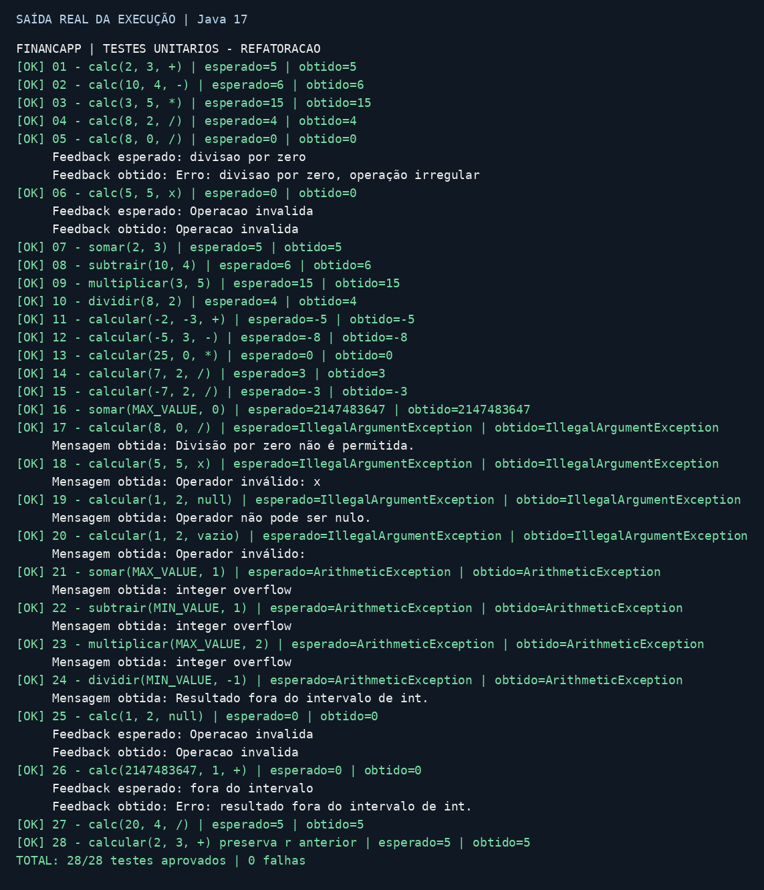
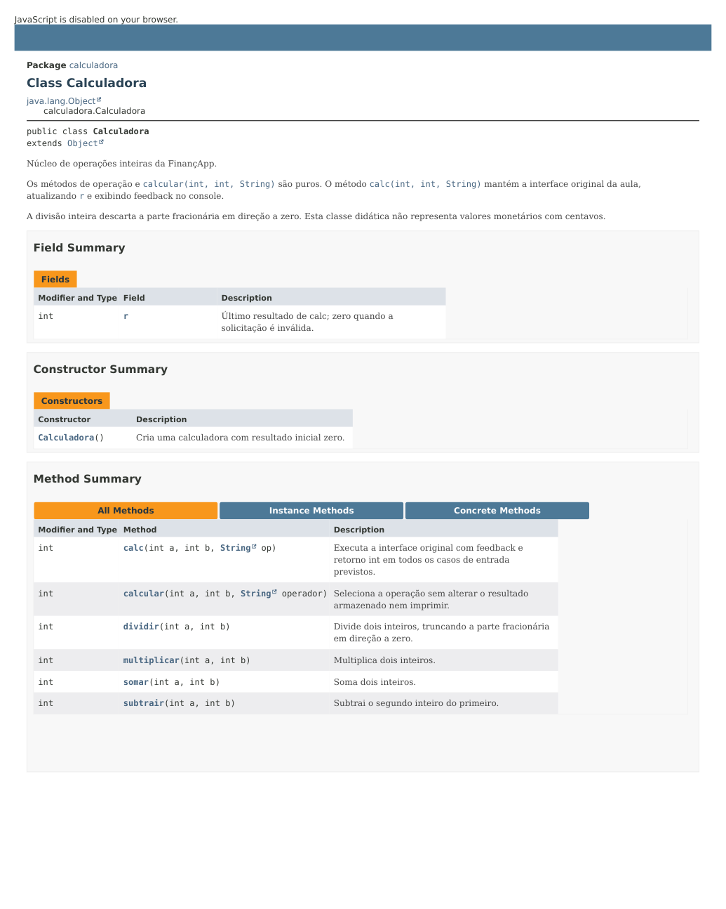

# Projeto Calculadora — FinançApp

> Atividade individual. Projeto acadêmico desenvolvido com foco em Qualidade de Software, Testes, Refatoração, Documentação e Versionamento.

---

## 1. Identificação do Projeto

**Projeto:** Projeto Calculadora  
**Contexto:** FinançApp  
**Aluno:** Gabriel Henrique Fernandes Torres  
**RA:** 251157  
**Curso:** Análise e Desenvolvimento de Sistemas  
**Disciplina:** UX/UI e Testes de Software  
**Professor:** Daniel Ohata  
**Semestre:** 2026.2  

---

# 2. Visão Geral

O projeto consiste no desenvolvimento de um módulo de cálculos matemáticos básicos em Java para a startup fictícia **FinançApp**.

O módulo foi desenvolvido com o objetivo de ser utilizado futuramente em funcionalidades de controle financeiro, como:

- orçamento mensal;
- divisão de despesas;
- projeções financeiras;
- cálculos auxiliares.

Além do funcionamento correto das operações, o projeto aplica práticas de qualidade de software relacionadas a:

- testes;
- tratamento de erros;
- refatoração;
- documentação;
- versionamento;
- manutenção de código.

---

# 3. Problema

Durante o desenvolvimento da aplicação FinançApp, foi identificada a necessidade de criar um módulo matemático reutilizável.

Os requisitos da atividade determinam que o módulo, além de funcionar corretamente, deve apresentar:

- código legível;
- testes automatizados;
- tratamento de falhas;
- documentação técnica;
- controle de versões;
- facilidade de manutenção.

O desafio consiste, portanto, em desenvolver uma solução funcional e ao mesmo tempo aplicar boas práticas de Engenharia de Software.

---

# 4. Objetivo

## 4.1 Objetivo Geral

Desenvolver uma calculadora em Java aplicando práticas de qualidade, testes, documentação, refatoração e versionamento.

## 4.2 Objetivos Técnicos

- implementar operações matemáticas básicas;
- tratar entradas inválidas;
- impedir divisão por zero;
- desenvolver testes automatizados;
- refatorar o código sem alterar seu comportamento;
- documentar classes e métodos com JavaDoc;
- gerar documentação HTML;
- utilizar Git e GitHub;
- organizar commits e branches;
- manter documentação técnica no README.

---

# 5. Escopo Funcional

A aplicação deverá oferecer as seguintes operações:

| ID | Funcionalidade | Descrição | Status |
|---|---|---|---|
| RF01 | Soma | Soma dois números inteiros | ✅ |
| RF02 | Subtração | Subtrai dois números inteiros | ✅ |
| RF03 | Multiplicação | Multiplica dois números inteiros | ✅ |
| RF04 | Divisão | Divide dois números inteiros | ✅ |
| RF05 | Validação de divisão | Impede divisão por zero | ✅ |
| RF06 | Operação inválida | Trata operadores não suportados | ✅ |

---

# 6. Requisitos Não Funcionais

| ID | Categoria | Requisito |
|---|---|---|
| RNF01 | Qualidade | O código deve possuir organização e legibilidade |
| RNF02 | Testabilidade | As operações devem possuir testes automatizados |
| RNF03 | Manutenção | O código deve permitir refatoração sem alteração funcional |
| RNF04 | Documentação | Classes e métodos devem possuir JavaDoc |
| RNF05 | Versionamento | O projeto deve utilizar Git e GitHub |
| RNF06 | Confiabilidade | Erros não devem interromper inesperadamente a execução |

---

# 7. Tecnologias Utilizadas

| Tecnologia | Versão | Utilização |
|---|---|---|
| Java | 17 | Desenvolvimento |
| JDK | 17 | Compilação |
| Testes Java próprios | Sem dependências | 28 verificações automatizadas |
| Git | Histórico incluído | Controle de versão |
| GitHub | Repositório público | Repositório remoto |
| JavaDoc | — | Documentação |
| Terminal | Linha de comando | Compilação, testes e JavaDoc |

---

# 8. Estrutura do Projeto

- `src/calculadora/Calculadora.java`: classe da calculadora.
- `src/calculadora/TesteCalculadora.java`: testes unitários executáveis.
- `docs/index.html`: entrada da documentação JavaDoc.
- `evidencias/`: resultados reais dos testes e imagem da saída.
- `executar_testes.bat` e `executar_testes.sh`: execução dos testes.
- `gerar_documentacao.bat`: geração do JavaDoc.
- `README.md`: documentação do trabalho individual.

## Versionamento e resultado

As branches representam etapas do mesmo trabalho individual:
`main` contém a implementação inicial; `Refatoracao` contém a versão final.
Os **28 testes da versão final passaram**, sem falhas.
Repositório:
https://github.com/gabrieldolly11/projeto_calculadora

Versão final: https://github.com/gabrieldolly11/projeto_calculadora/tree/Refatoracao

## Compilar e executar

Requisito: JDK 17 ou superior, com `java`, `javac` e `javadoc` no PATH.
No Windows, abra `executar_testes.bat` ou execute na pasta do projeto:

```sh
javac -encoding UTF-8 -d bin src/calculadora/*.java
java -cp bin calculadora.TesteCalculadora
```

Os testes comparam valores, estado e mensagens. Não dependem da opção `-ea`.
Uma divergência lança `AssertionError` e termina a execução com falha.

## Refatoração realizada

A cadeia de condicionais foi substituída por seleção da operação em `calcular`.
Os cálculos foram extraídos para `somar`, `subtrair`, `multiplicar` e `dividir`.
Esses métodos não imprimem nem alteram o estado da calculadora.
O método original `calc(int a, int b, String op)` e o atributo público `r`
foram mantidos para compatibilidade com as especificações iniciais.

Os slides apresentam dois contratos: `calc` retorna zero e informa erros,
enquanto `calcular` lança exceções. Nesta solução ambos estão disponíveis:

| Interface | Operação válida | Entrada inválida |
| --- | --- | --- |
| `calc` | Retorna int, atualiza r e imprime | Retorna 0, zera r e imprime feedback |
| `calcular` | Retorna int sem efeitos colaterais | Lança exceção informativa |

Os seis casos originais foram preservados como regressão. O tratamento de
operador nulo e overflow foi acrescentado como melhoria de robustez,
separada conceitualmente da refatoração. Em vez de produzir resultado incorreto,
o overflow gera `ArithmeticException`, tratada por `calc`.
As exceções de `calcular` são capturadas nos testes; uma interface que usar esse
método também deve capturá-las e apresentar a mensagem ao usuário.

## Casos de teste

| Casos | Verificação |
| --- | --- |
| 01-06 | Quatro operações originais, divisão por zero e operador inválido |
| 07-10 | Cada método de operação isoladamente |
| 11-16 | Negativos, zero, divisão inteira e limite válido de int |
| 17-20 | Exceções e mensagens para zero, operador inválido, nulo e vazio |
| 21-24 | Overflow nas quatro operações |
| 25-26 | Tratamento de nulo e overflow pela interface original |
| 27 | Continuidade de uso depois de erro |
| 28 | Preservação do estado pelo método puro |

Há testes de caixa-preta para entradas e saídas e testes orientados à estrutura
para os métodos extraídos e caminhos de erro. O total aprovado descreve apenas
os casos executados; não constitui medição de cobertura de código.

## Evidência da execução

A imagem abaixo foi renderizada a partir da saída real gravada no arquivo de
texto ao executar o programa; não representa uma execução simulada.



## Prints da documentação JavaDoc

As imagens abaixo são renderizações dos arquivos HTML reais gerados pelo
JavaDoc. A primeira mostra o pacote, destino de `docs/index.html`; a segunda
mostra a classe Calculadora. A paginação foi adaptada para a captura.




## Link do repositório

[Repositório GitHub](https://github.com/gabrieldolly11/projeto_calculadora)

[Branch principal](https://github.com/gabrieldolly11/projeto_calculadora/tree/main) | [Branch Refatoracao](https://github.com/gabrieldolly11/projeto_calculadora/tree/Refatoracao)

## Documentação

Classes, métodos, parâmetros, retornos e exceções estão documentados com JavaDoc.
Para regenerar:

```sh
javadoc -private -encoding UTF-8 -charset UTF-8 -docencoding UTF-8 -d docs -sourcepath src -subpackages calculadora
```

## Observações do contrato

A divisão é inteira: `7 / 2` resulta em `3` e `-7 / 2` em `-3`.
Por exigência da atividade, o retorno é `int`. Em um sistema financeiro de
produção, valores com centavos exigiriam outra representação, como `BigDecimal`.
O retorno zero de `calc` pode ser tanto um resultado válido quanto um erro:
a mensagem de feedback distingue os casos; `calcular` distingue por exceção.

## Acessar o projeto

```sh
git clone https://github.com/gabrieldolly11/projeto_calculadora.git
cd projeto_calculadora
git switch Refatoracao
```

A branch `main` preserva o código inicial. A branch `Refatoracao` contém
os testes detalhados, a documentação e as evidências da versão final.

## Material de referência

UIUX_FUNCIONAIS_DOCUMENTACAO_REFATORACAO_AULA_09.pdf, slides 37 a 47.
O exemplo posterior de conta bancária demonstra a geração de JavaDoc no Eclipse.
